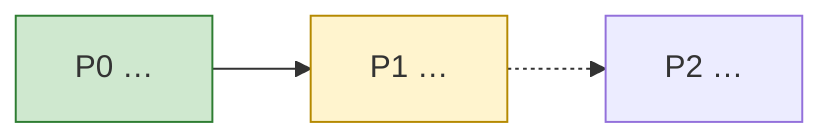

# <effort> — plan

> Realizes design.md (D-…). Architecture: architecture.md · Contracts: contracts.md. Law order: D-n › contracts ›
> architecture › this plan › the stage lists.

## 1. Phases
| phase | deliverable (deployable) | builds on (pins) | DONE evidence (attemptable at this phase's end) | depends on |
|---|---|---|---|---|

## 2. Stages per phase
### P<n> — <title>
| stage | after | goal (testable) | ~task titles | rolls · live · touches | pre-flight | DONE |
|---|---|---|---|---|---|---|

`after`: the stages and phases of this plan the stage waits for — ids only (`S<n.m>`, `P<n>`), separated by commas, or
`—` for none; the daemon reads a stage's wave from it (contracts.md §4.4, Amendment 32), so prose belongs in pre-flight.

## 3. Dependency chart

Solid = needs the exit; dashed = the frozen contract suffices. Refreshed at every phase exit. Waves are gates.

## 4. Open questions and assumptions (each with a default)
