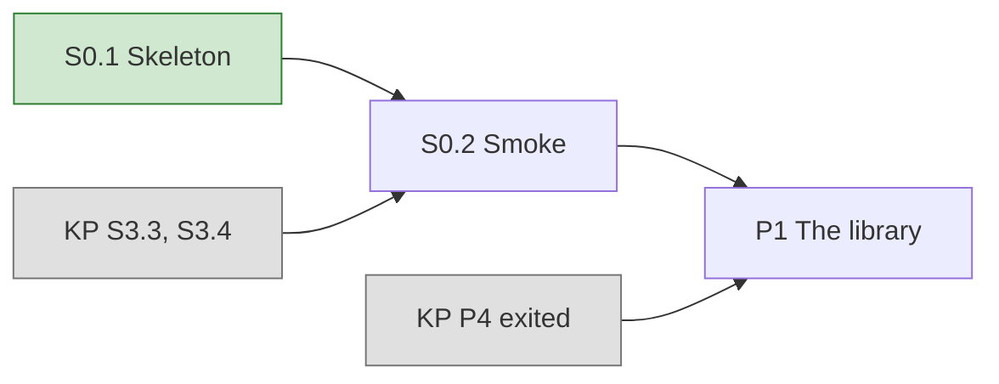

# TOY — plan

> The toy project of Keporkak v1 (D-40 S-9, D-47, D-48): a small Kotlin library that exists so the platform has
> something real to carry. Repo `Collite/kp-toy`. Architecture: `architecture.md` · Contracts: `contracts.md` (both
> in this folder). Law order: D-n (KP's control room) › contracts › architecture › this plan › the stage lists.
> **The toy is a fixture with real CI.** Its stages are sized to exercise the platform, not to be useful.

## 1. Phases
| phase | deliverable | builds on (pins) | DONE evidence — attemptable at this phase's end | depends on |
|---|---|---|---|---|
| **P0 Skeleton and smoke** | a repo that builds in CI; one stage carried by the daemon | JVM 21 | CI green on master · S0.2 exited, carried by the daemon with no hand-recorded line in its log | S0.2 waits for KP/P3's stages S3.3 and S3.4 |
| **P1 The library** | parse, format, a demo service | the skeleton | S1.1–S1.3 exited · the log shows the paths named in §2 | KP/P4 exited |

## 2. Stages per phase

Every stage: `rolls: none · touches: none`; `live: none` unless stated.

### P0 — Skeleton and smoke
| stage | after | goal (testable) | ~tasks | pre-flight | DONE |
|---|---|---|---|---|---|
| **S0.1 The skeleton** (by hand) | — | an empty library that builds and tests in CI | specs · the build · the module layout · recipes · CI · the pointer to this plan | the repo exists | CI green on the PR's head and on master |
| **S0.3 The docs standard** (by hand, before KP P4; KP D-102) | S0.1 | the toy's one unit has a map page that says what it covers and at which commit it was verified, a catalog file whose relations are generated, and checks that hold both | specs · the page format · the catalog script · the checks in `just check` | S0.1 merged | `just check` is red on a stale page and on a catalog that drifted, and green after each is brought up to date |
| **S0.2 Smoke** (the daemon's first carried stage; KP S3.5) | S0.1 | the library reports its own version | one behaviour, six tasks (KP D-128) | KP S3.3, S3.4 merged | the stage exits through the daemon |

### P1 — The library (carried by Keporkak; KP/P5)
| stage | goal (testable) | live | what it makes the platform do |
|---|---|---|---|
| **S1.1 Parse** | text → `Duration`, with named errors (contracts.md §1) | none | the happy path; the exit of a stage that rolls nothing and has no live target |
| **S1.2 Format, and a consumer** | `Duration` → canonical text; a consumer module pinned to a library release | none | **H-1′.** The release the consumer needs is deliberately not published: the coder must stop with `SC-3`, the Principal resumes with a stub, the Found line becomes a pin stage. During the stage the coder's process is killed once, on purpose, to force a re-seat |
| **S1.3 The demo** | a small HTTP service over the library (contracts.md §2) | **bp-dsk** | **H-3, small.** A `[QA]` item: QA runs the candidate as a temp pod in `qa-toy-s1-3`, saves the fixture, drops the namespace; the stage exits by D-42 |

The two planted triggers of S1.2 are written into its list's pre-flight when it is cut, so nobody mistakes them
for accidents.

## 3. Dependency chart

Solid = needs the exit. Refreshed at every phase exit.

## 4. Open questions and assumptions (each with a default)
- **The published coordinates** of the library and the registry it would be released to are decided when S1.2 is
  cut. Default: GitHub Packages of `Collite/kp-toy`; nothing is published before the pin stage that S1.2 provokes.
- **The demo's image** is built by CI on the stage's PR and pulled by QA's temp pod. Default: the repository's
  container registry; no GitOps entry, no realm client, no ingress.
- **Lists of P1** are cut when KP/P4 exits.
